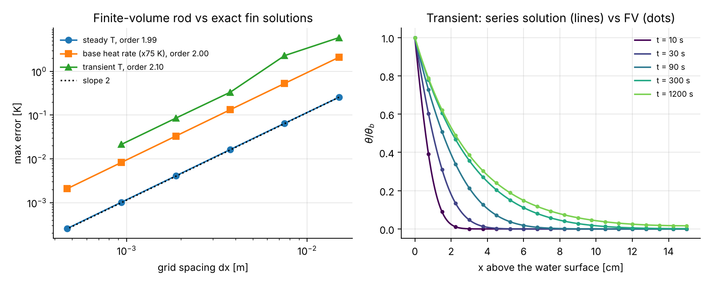
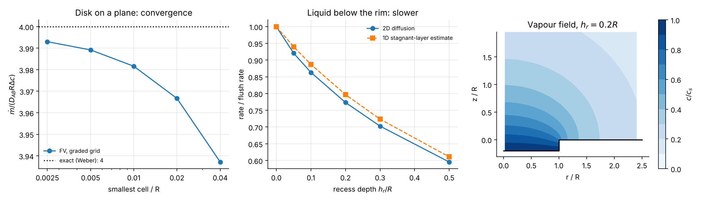
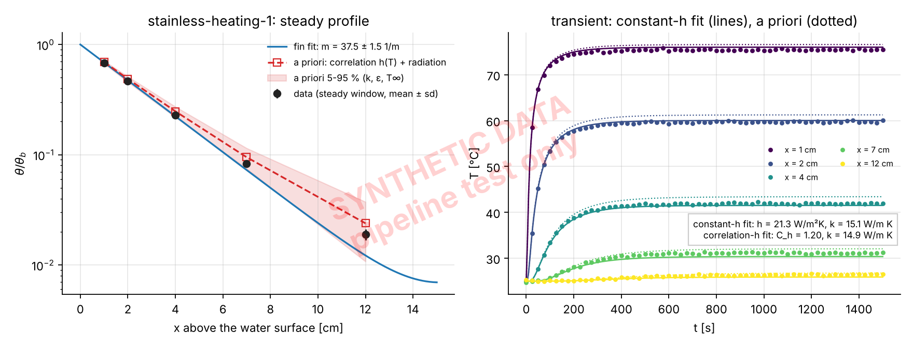
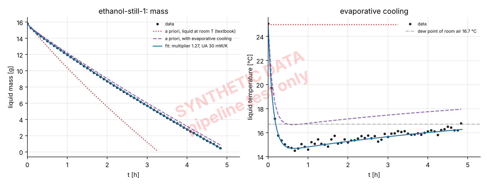

# Everyday-Transport-Phenomena

[](https://github.com/Shuruyue/Everyday-Transport-Phenomena/actions/workflows/ci.yml)


Models, inverse analysis and verification for the two self-study assignments of **Transport
Phenomena II** (Yuan Ze University, CEMS): a metal rod heated in boiling water and cooled in air
(Week 1, heat transfer), and evaporation of ethanol from a tube and an open dish (Week 2, mass transfer).

> **Status:** code, verification and the full pipeline are done; the experiments are not yet.
> Every figure under `results/synthetic/` comes from **synthetic data** (watermarked) and only tests
> the pipeline. Real results will appear under `results/week1/` and `results/week2/`.

Beyond the course calculation (measure, apply Fourier/Newton/Fick, compute), each assignment adds a
model that is verified against exact solutions, a fit that returns parameters with confidence
intervals, and a quantified comparison between the textbook idealization and what the experiment
actually does.

| | Course-level analysis | Extension in this repository |
|---|---|---|
| Week 1 | Fourier heat rate at the base, lumped cooling, h from Newton's law, time to room temperature | multi-point fin profile; transient 1D finite-volume model with h(T) and radiation; h and k fitted separately; instantaneous h(ΔT) vs Churchill-Chu; fan speed inverted from the cooling curve |
| Week 2 | Fuller D_AB, Stefan flux, k_c from mass loss, evaporation time | Stefan-tube D_AB with a moving-boundary check of the pseudo-steady law; evaporative cooling coupled to mass transfer; stable vapour layer in still air; 2D diffusion field over a recessed dish; 75 % ethanol with NRTL and water uptake from humid air |
| Both | | **heat-mass analogy across the two assignments**: the fan speed found from the Week 1 rod predicts the Week 2 k_c (Chilton-Colburn) |

## Verification

Every solver is checked against an exact solution or a conservation law
(`python scripts/verify.py`, `figures/verification/`).

| Solver | Reference | Result |
|---|---|---|
| 1D finite-volume rod (steady, transient, base heat rate) | analytical fin and series solutions | observed order 1.99 / 2.10 / 2.00 |
| Lumped cooling with h(T) and radiation | exponential solution; energy balance | agreement to 1e-7 K; energy closes to 1e-6 |
| Stefan tube, transient PDE with moving interface | pseudo-steady $z^2 - z_0^2 = Kt$ | slope K within 0.2 %; offset 1.7 µm (estimate 1.9 µm) out of a 12 mm drop |
| 2D axisymmetric diffusion from a disk | Weber, $\dot m = 4DR\Delta c$ | 3.993 vs 4 (0.18 %), first-order convergence from the edge singularity |
| Coupled evaporation ODE | independent wet-bulb root | steady liquid temperature equal to 2e-5 K |
| NRTL ethanol-water | azeotrope from [Ethanol-Water-VLE](https://github.com/Shuruyue/Ethanol-Water-VLE) | x₁ = 0.897, 78.17 °C reproduced |
| Every fit | synthetic data with known truth | parameters recovered within their intervals (`tests/test_inverse.py`) |




## What the design estimates already say

From `python scripts/design_estimates.py` (full tables in [`docs/design_estimates.md`](docs/design_estimates.md)):

- **Stainless steel barely conducts.** A 4 mm 304 rod has $1/m \approx 3$ cm: 15 cm above boiling water
  its tip stays at ~26 °C. Measuring only the tip would show almost nothing, so the plan measures
  along the rod and adds an aluminium or copper rod for contrast.
- **Fast cooling needs fast sampling.** With a fan, τ ≈ 40-70 s; readings every 30 s are too sparse,
  so temperatures are read from video at ≤ 5 s.
- **Evaporating ethanol cools itself to 6-11 °C.** Its vapour pressure there is 30-40 % of the
  25 °C value; assuming the liquid stays at room temperature over-predicts the rate 2-3 times.
- **Still air is not "natural convection" in the usual sense.** Ethanol vapour is heavier than air
  and the surface is cold, so the layer is stable ($Sh = 0.52Ra^{1/5}$).
- **Humid air condenses into cold ethanol.** In Taiwan's typical 60-80 % RH the dew point (17-21 °C)
  sits above the liquid temperature.

## Pipeline test on synthetic data

`config/synthetic/` describes the planned set-up and a hidden `[truth]`. The data are generated with a
richer model than the analysis fits (finer grid, h(T), radiation, k and D different from the handbook,
an anemometer reading that is slightly off), so the test is not circular.




One lesson already visible: a k_c "correlation multiplier" fitted with Fuller's D and an imperfect fan
reading comes out 6-12 % below the truth; with the true D and U the same pipeline returns the true
value. On real data the multiplier measures correlation, property and air-speed error together, and
the report has to say so.

## Quick start

```bash
git clone https://github.com/Shuruyue/Everyday-Transport-Phenomena.git
cd Everyday-Transport-Phenomena
pip install -r requirements-lock.txt && pip install -e . --no-deps
pytest -q                                   # 47 tests, ~10 s
python scripts/verify.py                    # verification figures
python scripts/design_estimates.py          # docs/design_estimates.md
python scripts/make_synthetic_data.py       # pipeline test data
python scripts/week1_analysis.py config/synthetic/week1.toml
python scripts/week2_analysis.py config/synthetic/week2.toml
```

## Running it on your own measurements

1. Record data in the formats of `data/templates/` and save them under `data/raw/`.
2. Fill in every `"MEASURE"` in `config/week1.toml` and `config/week2.toml` (units are in the key
   names). The analysis refuses to start while a placeholder is left.
3. `python scripts/week1_analysis.py config/week1.toml`, then the same for Week 2 (Week 2 reads the
   Week 1 fan speed for the analogy check).
4. Figures, `*_results.json` and `summary.md` appear in `results/week1/` and `results/week2/`.

A Traditional Chinese walk-through is in [`docs/guide_zh-TW.md`](docs/guide_zh-TW.md).

## Repository layout

```
src/etp/
  properties.py, correlations.py, diffusivity.py   air/ethanol/water/metal data, h and k_c correlations, D_AB
  heat/fin.py, heat/fin_fv.py                       analytical fin solutions, 1D finite-volume rod
  heat/lumped.py, heat/inverse.py                   lumped cooling, fits (m; h and k; C_h; U_eff)
  mass/stefan.py                                    Stefan's law, D_AB fit, moving-boundary PDE
  mass/evaporation.py, mass/activity.py             coupled heat-mass evaporation model, NRTL
  mass/diffusion2d.py, mass/inverse.py              2D dish diffusion, k_c and model fits
  fitting.py, io.py, build.py, plotting.py          fits with intervals, config/CSV, unit conversion
scripts/   verify.py, design_estimates.py, make_synthetic_data.py, week1_analysis.py, week2_analysis.py
config/    week1.toml, week2.toml (to fill in), synthetic/ (pipeline test)
data/      templates/, raw/ (your measurements), synthetic/
docs/      derivations.md, design_estimates.md, guide_zh-TW.md
tests/     47 tests: exact solutions, convergence orders, conservation, parameter recovery
```

Units are SI inside the package; lab units (°C, cm, g, min) are converted only in `build.py`, `io.py`
and the scripts. Models never extrapolate silently: correlations, property fits and tables raise outside
their range.

## Models and assumptions

Derivations, and why each assumption is acceptable or not, are in [`docs/derivations.md`](docs/derivations.md):
fin equation and its transient series solution, why a steady profile only gives h/k, lumped cooling and the
instantaneous h, Stefan tube with the moving-boundary jump conditions, film model with the Stefan
correction, density-driven free convection, Chilton-Colburn and the wet-bulb temperature, the recess
resistance, NRTL and water uptake, and how the uncertainty is reported.

## References

- F. P. Incropera, D. P. DeWitt, T. L. Bergman, A. S. Lavine, *Fundamentals of Heat and Mass Transfer*, 7th ed. (air properties Table A.4, metals Table A.1, Churchill-Chu, horizontal-plate free convection).
- C. J. Geankoplis, *Transport Processes and Separation Process Principles* (Fuller et al. diffusion volumes, as used in the course).
- R. B. Bird, W. E. Stewart, E. N. Lightfoot, *Transport Phenomena*, 2nd ed. (Chapman-Enskog, Stefan diffusion).
- B. E. Poling, J. M. Prausnitz, J. P. O'Connell, *The Properties of Gases and Liquids*, 5th ed. (Lennard-Jones parameters, Watson correlation).
- NRTL parameters for ethanol-water: Aspen Plus databank (DDB), tabulated in Beneke et al., *Understanding Distillation Using Column Profile Maps*, Wiley 2013; see [Ethanol-Water-VLE](https://github.com/Shuruyue/Ethanol-Water-VLE).
- TP2 lecture notes (Dr. Ercan): Lectures 3, 5, 6-7, 10, 11-13.

## License

MIT
